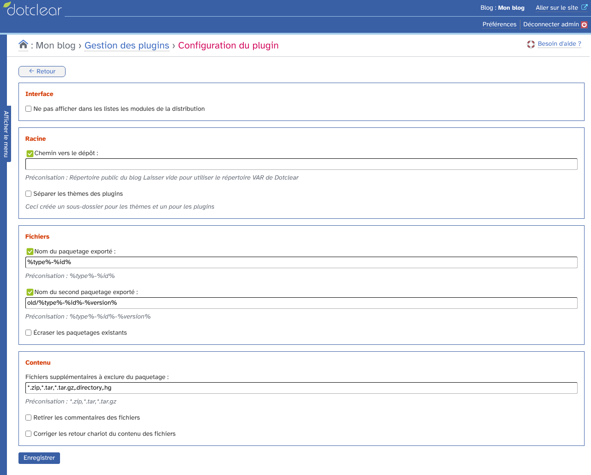
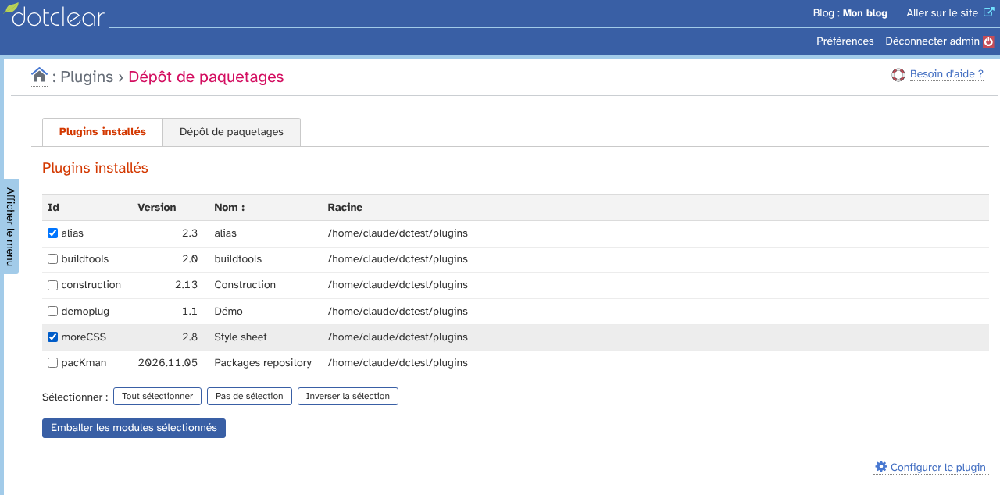
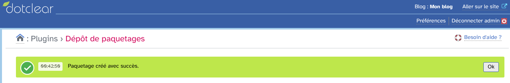
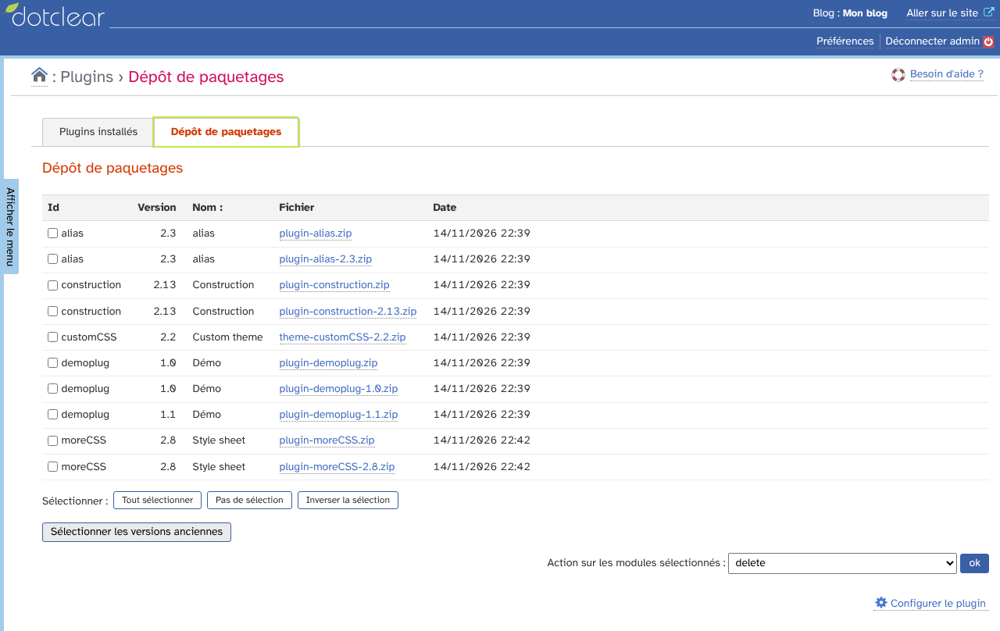
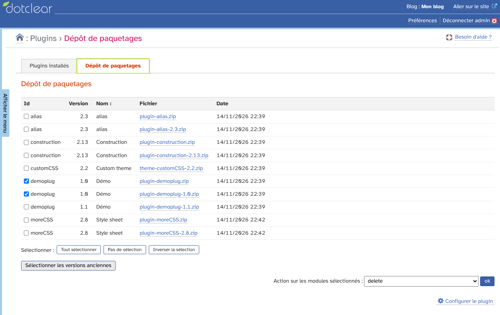
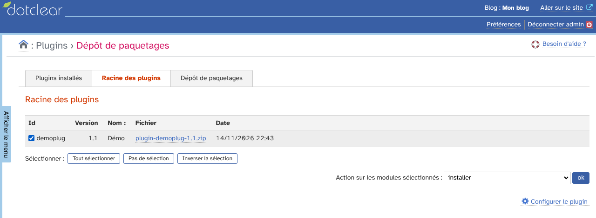

# pacKman : guide d'utilisation

pacKman crée des paquets zip de vos plugins et de vos thèmes, directement depuis l'administration de Dotclear.
Il range ces paquets dans un dépôt, d'où vous pouvez les copier, les déplacer, les supprimer ou les installer.

## Sommaire

* [Avant de commencer](#avant-de-commencer)
* [Régler le plugin](#régler-le-plugin)
* [Emballer un plugin ou un thème](#emballer-un-plugin-ou-un-thème)
* [Le dépôt de paquetages](#le-dépôt-de-paquetages)
* [Garder les anciennes versions](#garder-les-anciennes-versions)
* [Installer un paquet](#installer-un-paquet)
* [Séparer les thèmes et les plugins](#séparer-les-thèmes-et-les-plugins)
* [Ce qu'il faut savoir](#ce-quil-faut-savoir)

## Avant de commencer

Le plugin est réservé au super-administrateur de Dotclear.

Ouvrez le menu « Plugins », puis « Dépôt de paquetages ».
Vous pouvez aussi ajouter ce plugin à vos favoris du tableau de bord.

La page propose deux onglets au départ : « Plugins installés » et « Thèmes installés ».
Les autres onglets apparaissent quand des paquets existent.

Le dossier qui reçoit les paquets doit être accessible en écriture par le serveur.
Par défaut, c'est le dossier VAR de Dotclear.

## Régler le plugin

Les réglages sont dans le gestionnaire de plugins.
Ouvrez la page « Gestion des plugins », repérez pacKman puis cliquez sur « Configurer le plugin ».
Sur la page du plugin, le lien « Configurer le plugin » en bas à droite y mène aussi.

Les coches vertes à côté d'un champ indiquent que le dossier est accessible en écriture.

Le bloc « Interface » :

* **Ne pas afficher dans les listes les modules de la distribution** : masque les plugins et les thèmes livrés avec Dotclear. Il ne reste que les vôtres.

Le bloc « Racine » :

* **Chemin vers le dépôt** : le dossier où les paquets sont créés. Laissez vide pour utiliser le dossier VAR de Dotclear.
* **Séparer les thèmes des plugins** : crée un sous-dossier pour les thèmes et un pour les plugins. Voir plus bas.

Le bloc « Fichiers » :

* **Nom du paquetage exporté** : le nom du premier paquet, sans `.zip`. Par défaut : `%type%-%id%`.
* **Nom du second paquetage exporté** : un deuxième paquet, créé en même temps. Par défaut : `%type%-%id%-%version%`. Laissez vide pour n'en créer qu'un.
* **Écraser les paquetages existants** : remplace un paquet du même nom au lieu de le laisser tel quel.

Dans les noms, ces mots sont remplacés par les informations du module :

| Mot | Remplacé par |
|---|---|
| `%type%` | `plugin` ou `theme` |
| `%id%` | l'identifiant du module |
| `%version%` | la version du module |
| `%author%` | l'auteur du module |
| `%time%` | l'heure de création |

Un nom peut commencer par un dossier, par exemple `old/%type%-%id%-%version%`.
Ce dossier doit déjà exister dans le dépôt.

Le bloc « Contenu » :

* **Fichiers supplémentaires à exclure du paquetage** : des noms séparés par des virgules. Le joker `*` est permis. Par défaut : `*.zip,*.tar,*.tar.gz,.directory,.hg`.
* **Retirer les commentaires des fichiers** : enlève les commentaires des fichiers PHP dans le paquet. Vos fichiers ne changent pas.
* **Corriger les retour chariot du contenu des fichiers** : uniformise les fins de ligne dans le paquet.

Quelques fichiers sont toujours exclus : `.svn`, `.git*`, `.hg*`, `CVS`, `.DS_Store`, `Thumbs.db`, `__MACOSX` et `_disabled`.

Cliquez sur « Enregistrer ».

Si un dossier n'est pas accessible en écriture, la page du plugin affiche le message « Le module "Dépôt de paquetages" est mal configuré » avec la raison, et n'affiche plus les listes.

## Emballer un plugin ou un thème

1. Ouvrez l'onglet « Plugins installés » (ou « Thèmes installés »).
2. Cochez les modules à emballer.
3. Cliquez sur « Emballer les modules sélectionnés ».

La page affiche le message « Paquetage créé avec succès. »

Chaque module donne un ou deux paquets, selon les noms réglés.
Avec les réglages par défaut, pour le plugin `alias` en version 2.3 :

* `plugin-alias.zip` : le dernier paquet créé ;
* `plugin-alias-2.3.zip` : le paquet de la version 2.3, qui garde cette version.

Si un paquet du même nom existe déjà et que « Écraser les paquetages existants » n'est pas coché, il est laissé tel quel.

## Le dépôt de paquetages

L'onglet « Dépôt de paquetages » liste les paquets créés : identifiant, version, nom, fichier et date.

Pour agir sur des paquets :

1. Cochez-les.
2. Choisissez une action dans « Action sur les modules sélectionnés ».
3. Cliquez sur « ok ».

Les actions sont :

* **delete** : supprime les paquets. Il n'y a pas de confirmation ;
* **copier dans le répertoire des extensions** : copie les paquets dans le dossier des plugins de Dotclear ;
* **déplacer dans le repertoire des extensions** : copie les paquets, puis les supprime du dépôt ;
* **copier dans le répertoire des thèmes** et **déplacer dans le repertoire des thèmes** : pareil, vers le dossier des thèmes.

Si aucun paquet n'est coché, la page affiche « Aucun module sélectionné. »

Dans une liste, les trois boutons « Tout sélectionner », « Pas de sélection » et « Inverser la sélection » aident à cocher plusieurs lignes.

## Garder les anciennes versions

Quand vous créez un paquet à chaque nouvelle version, le dépôt se remplit.
Le bouton « Sélectionner les versions anciennes » coche, pour chaque module, tous les paquets d'une version plus ancienne que la dernière.

Choisissez ensuite l'action « delete » et cliquez sur « ok » pour faire le ménage.

Ici, la version 1.1 de `demoplug` est conservée, et les deux paquets de la version 1.0 sont cochés.

## Installer un paquet

L'installation passe par le dossier des plugins de Dotclear.

1. Dans « Dépôt de paquetages », cochez le paquet.
2. Choisissez « copier dans le répertoire des extensions » et cliquez sur « ok ».
3. Un onglet « Racine des plugins » apparaît. Cochez le paquet.
4. Choisissez « installer » et cliquez sur « ok ».

La page affiche « Paquetage installé avec succès. »
Le plugin apparaît dans « Plugins installés », et le paquet disparaît de « Racine des plugins ».

Pour un thème, utilisez « copier dans le répertoire des thèmes » : l'onglet « Racine des thèmes » propose alors « installer ».

Si le module existe déjà, il est remplacé par le contenu du paquet, même si la version du paquet est plus ancienne.

## Séparer les thèmes et les plugins

Cochez « Séparer les thèmes des plugins » dans les réglages.
Les paquets sont alors rangés dans deux sous-dossiers du dépôt, `plugins` et `themes`, et la page affiche un onglet de dépôt pour chacun.

Si le nom du second paquet commence par un dossier (`old/…`), ce dossier doit exister dans chacun des deux sous-dossiers.
Sinon, la page affiche « Le chemin vers le second paquetage exporté n'est pas accessible en écriture. » et n'affiche plus les listes.

## Ce qu'il faut savoir

* Avec les réglages par défaut, les deux paquets sont dans le même dossier : chaque paquet apparaît alors deux fois dans la liste du dépôt. Pour l'éviter, rangez le second paquet dans un sous-dossier existant, par exemple `old/%type%-%id%-%version%`.
* Les paquets contiennent tout le dossier du module, sauf les fichiers exclus.
* Les paquets ne sont pas téléchargeables depuis la page : récupérez-les dans le dossier du dépôt.
* Les actions « delete » et « déplacer » n'ont pas de confirmation ni d'annulation.
* Le changement de dossier du dépôt ne déplace pas les paquets déjà créés.
